<div align="center">



<a href="https://git.io/typing-svg"></a>

<a href="https://www.linkedin.com/in/axlrubiotavara/"></a>
<a href="mailto:axl.contactos.dev@gmail.com"></a>


</div>

```bash
┌──(axlrubio㉿github)-[~]
└─$ whoami
```

```csharp
namespace GitHub.Profile
{
    public sealed class AxlRubio : Developer, IProblemSolver
    {
        public string   Rol        => "Software Developer | IT & Database Solutions";
        public string   Ubicacion  => "Perú";
        public string[] Lenguajes  => new[] { "C#", "Python", "PHP", "SQL", "JavaScript" };
        public string[] Enfoque    => new[] { "Desarrollo", "Integración", "Datos", "Infraestructura IT" };

        public void Trabajar(Problema problema)
        {
            var analisis = Entender(problema);          // 1. entender de verdad
            var diseno   = DisenarSolucion(analisis);   // 2. diseñar algo claro
            Construir(diseno, objetivo: "software que realmente sea útil");
        }
    }
}
```

---

## `> SELECT * FROM stack;`

```sql
SELECT categoria, tecnologias
FROM   dbo.MiStack
WHERE  uso = 'Producción'
ORDER  BY experiencia DESC;
```

```text
+-----------------+-------------------------------------------------------+
| categoria       | tecnologias                                           |
+-----------------+-------------------------------------------------------+
| Escritorio      | C#, .NET Framework, Windows Forms                     |
| Scripting       | Python, Tkinter, PowerShell                           |
| Web             | PHP, HTML, CSS, JavaScript                            |
| Bases de datos  | SQL Server, SAP HANA, MySQL, SQLite                   |
| Infraestructura | Windows, Linux, redes, hardware y soporte             |
+-----------------+-------------------------------------------------------+
(5 rows affected)
```

<div align="center">


<br/>

<br/><br/>


</div>

---

## `> Get-Servicio -Dev AxlRubio`

```powershell
PS C:\Users\axlrubio> Get-Servicio -Dev AxlRubio | Format-Table -AutoSize

Status   Name              Description
------   ----              -----------
Running  Desktop-Apps      Interfaces, formularios y sistemas de gestión con .NET
Running  Automatizacion    Scripts Python, transformación de datos, tareas repetitivas
Running  Datos-Reportes    Consultas SQL y extracción desde SQL Server / SAP HANA
Running  Integracion       Conexión entre aplicaciones, bases de datos y flujos de info
Running  Soporte-IT        Redes, equipos, impresoras y entornos Windows/Linux
```

---

## `> ls ~/proyectos`

```bash
$ git status
On branch main
Your branch is up to date with 'origin/main'.

Changes not staged for commit:
  (los primeros repos públicos están en camino 🚧)

        new file:   proyectos/app-escritorio-dotnet/      [C# · .NET · WinForms]
        new file:   proyectos/automatizacion-python/      [Python · Tkinter · SQL]
        new file:   proyectos/reportes-sql-server/        [SQL Server · SAP HANA]
        new file:   proyectos/integracion-php/            [PHP · APIs · BD]

$ make build
[████████████░░░░░░░░] 60%  Compilando proyectos... vuelve pronto 👀
```

---

## `> git stats --user axlrubio`

<div align="center">


<!-- 🐍 Snake de contribuciones (requiere el workflow snake.yml) -->
<picture>
  <source media="(prefers-color-scheme: dark)" srcset="https://raw.githubusercontent.com/axlrubio/axlrubio/output/github-snake-dark.svg" />
  
</picture>

</div>

---

## `> python ahora.py`

```python
estado_actual = {
    "aprendiendo":  "Arquitectura de software y buenas prácticas",
    "compartiendo": "Conocimientos de programación con la comunidad",
    "abierto_a":    ["Colaboraciones", "Automatización", "Integración de sistemas",
                     "Soluciones empresariales"],
    "lema":         "La tecnología tiene valor cuando resuelve problemas reales.",
}

if __name__ == "__main__":
    print("¿Tienes una idea? Conversemos 🤝")
```

<div align="center">

```bash
$ echo "Gracias por visitar mi perfil 👋" && exit 0
```


</div>
